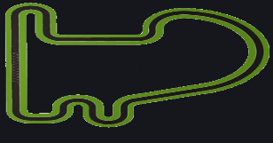
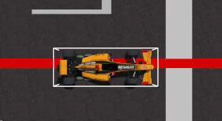
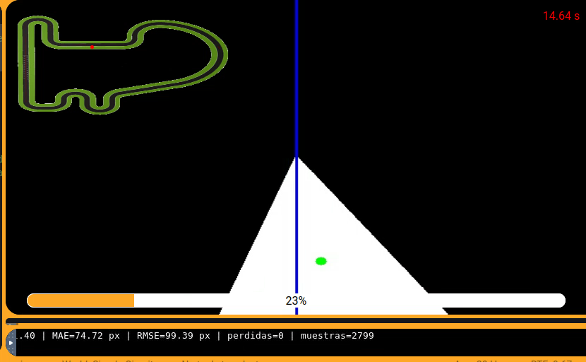

# Follow Line — Unibotics

En esta práctica se programa un coche simulado para que siga una línea roja usando la imagen de su cámara. Empecé con un controlador **P**, añadí por separado los términos **D** e **I**, probé el **PID** completo y terminé comparando distintas estrategias de **velocidad adaptativa**.

El objetivo no era solo completar el circuito, sino ver qué cambios mejoraban realmente el seguimiento y qué ocurría cuando se intentaba ir más rápido.

## Cómo ejecutar los programas

1. Abre el ejercicio **Follow Line** en Unibotics.
2. Entra en su editor de Python y copia el contenido del archivo `.py` que quieras probar.
3. Ejecuta el programa y comprueba que se detecta la línea roja y el vehículo comienza a seguirla.
4. Para repetir un experimento, ajusta únicamente las ganancias o los parámetros señalados en la prueba y reinicia la ejecución para poner a cero los contadores.
5. Los programas muestran en consola métricas acumuladas de seguimiento. Los tiempos por vuelta se tomaron de la propia web.

Los scripts están pensados para el entorno de Unibotics, que proporciona los módulos `HAL` y `WebGUI`. No son programas independientes que se ejecuten directamente en un ordenador sin ese entorno.

## Archivos principales

| Carpeta | Contenido |
|---|---|
| [`01_P`](01_P/) | Control proporcional (P). |
| [`02_PD`](02_PD/) | Control PD y variantes adaptativas/continuas. |
| [`03_PI`](03_PI/) | Control PI. |
| [`04_PID`](04_PID/) | Control PID. |
| [`05_velocidad_adaptativa`](05_velocidad_adaptativa/) | Pruebas con velocidad variable usando PD y PID. |
| [`06_resultados`](06_resultados/) | Registro de pruebas, resumen y gráficas. |
| [`docs`](docs/) | Notas de Obsidian: fundamentos, visión, experimentos y conclusiones. |

## Cómo funciona

La cámara obtiene imágenes del circuito. El programa convierte cada fotograma a **HSV**, identifica el rojo mediante dos rangos de color, descarta la parte superior de la imagen y busca el contorno válido de mayor área. A partir de su centroide calcula el error horizontal respecto al centro de la cámara:

$$
e = x_{\text{línea}} - \frac{w}{2}
$$

Con ese error, el controlador calcula la velocidad angular que se envía a `HAL.setW()`. La velocidad lineal se envía con `HAL.setV()`. En las comparaciones iniciales fue constante (`V = 10`), mientras que en la última fase se ajustó según las señales visuales de error y posible curva.

Si la línea deja de detectarse, se activa una maniobra de búsqueda con `V_LOST = 4` y `W_LOST = 1.9`. Este comportamiento se mantuvo igual al comparar los controladores.

Para la explicación detallada, consulta [Visión artificial](docs/02%20-%20Visi%C3%B3n%20artificial.md) y [Fundamentos del control](docs/01%20-%20Fundamentos%20del%20control.md).

## Resultados a velocidad constante

En cada configuración se hicieron **tres ejecuciones**. Esta tabla selecciona el ajuste con menor MAE medio de cada familia, entre los valores probados:

| Controlador | Ganancias | MAE medio (px) | RMSE medio (px) | Pérdidas (3 ejecuciones) |
|---|---|---:|---:|---:|
| P | `Kp=0.010` | 124,40 | 153,76 | 2 |
| PI | `Kp=0.010`, `Ki=0.00005` | 138,99 | 165,60 | 0 |
| PD | `Kp=0.010`, `Kd=0.001` | 58,88 | 85,19 | 0 |
| PID | `Kp=0.010`, `Ki=0.00001`, `Kd=0.001` | **57,75** | **84,04** | 0 |

El mayor cambio se produjo al introducir la derivada: **PD redujo mucho las oscilaciones observadas y el error visual respecto a P**. El PID obtuvo un error algo menor, pero la mejora sobre PD fue pequeña. Por eso considero PD una opción especialmente interesante por precisión y sencillez.

## Velocidad adaptativa

Después se probó acelerar en tramos favorables y reducir velocidad cuando aumentaban el error lateral o un indicador visual de curva.

| Configuración | Intervalo de velocidad | Tiempo web medio (s) | MAE medio (px) | Pérdidas |
|---|---|---:|---:|---:|
| PD adaptativo inicial | 8–15 | 68,32 | 72,16 | 0 |
| PID adaptativo inicial | 8–15 | 71,18 | 72,39 | 0 |
| PD adaptativo, más frenado | 8–15 | 71,55 | **67,81** | 0 |
| PD adaptativo, más rápido | 10–20 | **53,42** | 126,75 | 1 |

El ajuste de velocidad máxima 20 completó las tres ejecuciones registradas, pero con un error mucho mayor. Esto ilustra el compromiso entre **rapidez y precisión**. También se comprobó que una versión continua podía seguir circulando durante varias vueltas seguidas.

Los tiempos corresponden al cronómetro de la web, sensible a la carga gráfica del ordenador, así que son **orientativos**. MAE y RMSE miden desviaciones de la línea en **píxeles de imagen**, no distancia física, y se calculan sobre detecciones válidas.

Puedes revisar los datos originales en [`06_resultados/registro.csv`](06_resultados/registro.csv) y el análisis completo en [Comparativa y conclusiones](docs/08%20-%20Comparativa%20y%20conclusiones.md).

## Capturas y demostración

### Vista general del circuito

El recorrido presenta rectas, curvas amplias y giros más cerrados, que permiten observar diferencias entre controladores.

### Vehículo sobre la línea

### Detección visual utilizada por el controlador

Este fotograma se ha extraído de la grabación de la prueba: la línea blanca corresponde a la máscara, la referencia azul indica el centro de la imagen y el punto verde marca el centroide estimado. El error se obtiene a partir de su separación horizontal.

### Vídeo del PD con velocidad adaptativa

[Ver demostración del PD adaptativo (MP4, 18 s)](media/demo_pd_adaptativo.mp4)

El vídeo muestra un fragmento del seguimiento y las métricas que aparecen durante la ejecución. Los registros completos de las pruebas se encuentran en `06_resultados/`.

## Documentación

La carpeta [`docs/`](docs/) se puede abrir como bóveda de **Obsidian**. Contiene el índice, la explicación de la visión artificial y los experimentos por controlador, además de la comparativa final.

## Conclusión

Lo más llamativo fue comprobar que añadir más términos no implica necesariamente un mejor comportamiento. En este circuito, **la derivada aportó la mejora más clara**; la integral no ayudó cuando se utilizó junto a P en las ganancias ensayadas, y el PID quedó muy cerca del PD. La velocidad adaptativa permitió reducir los tiempos registrados, pero al aumentar demasiado la velocidad también creció el error.
