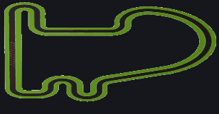
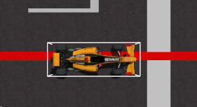
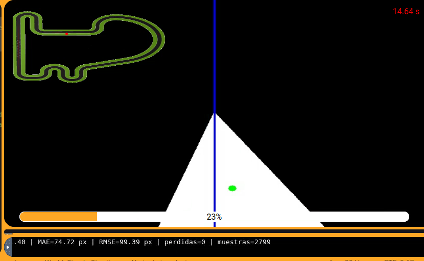

# Follow Line — Diario del proyecto

Este proyecto recoge el desarrollo del ejercicio **Follow Line** de Unibotics, centrado en el análisis de controladores **P, PI, PD y PID** para el seguimiento visual de una línea roja.  

Además de estudiar el comportamiento de cada controlador a velocidad constante, también se ha probado una estrategia de **velocidad adaptativa** para analizar el compromiso entre rapidez y precisión.

## Estructura de la documentación

- [[01 - Fundamentos del control]]
- [[02 - Visión artificial]]
- [[03 - Experimentos P]]
- [[04 - Experimentos PD]]
- [[05 - Experimentos PI]]
- [[06 - Experimentos PID]]
- [[07 - Velocidad adaptativa]]
- [[08 - Comparativa y conclusiones]]

## Demostración visual

### Vista general del circuito en el que corre el coche

### Vista del coche en la simulación

### Detección visual de la línea

### Vídeo de demostración

- [Ver vídeo del controlador PD adaptativo](../media/demo_pd_adaptativo.mp4)

## Resumen rápido de resultados

- El controlador **P** consigue completar el circuito, pero presenta más oscilaciones.
- El controlador **PI** no mejoró los resultados en las configuraciones probadas.
- El controlador **PD** fue el que ofreció el mejor equilibrio entre precisión, estabilidad y simplicidad.
- El **PID** obtuvo errores ligeramente menores que PD, pero la mejora fue pequeña.
- La **velocidad adaptativa** permitió reducir el tiempo de vuelta, aunque al aumentar demasiado la velocidad también aumentó el error de seguimiento.
## Cómo vamos a comparar

En cada configuración intentaremos completar **tres vueltas**, sin modificar a la vez la detección de línea, la velocidad y las ganancias del controlador. Apuntaremos el tiempo mostrado por Unibotics, si termina el recorrido, las pérdidas de línea y las oscilaciones que observemos.

**Importante:** el tiempo de la web puede depender de la carga gráfica del ordenador, en este caso tan solo acelerado por gráfica. Por eso no lo tomaremos como una medida perfecta del rendimiento del controlador: también importan la estabilidad y la capacidad de superar las curvas.

## Gráficas principales

![[01_comparativa_controladores.png]]

![[03_compromiso_velocidad_precision.png]]

