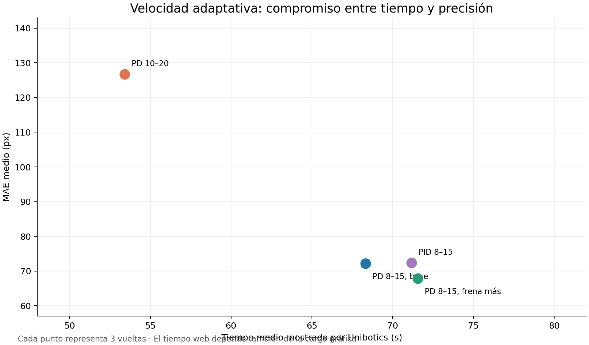
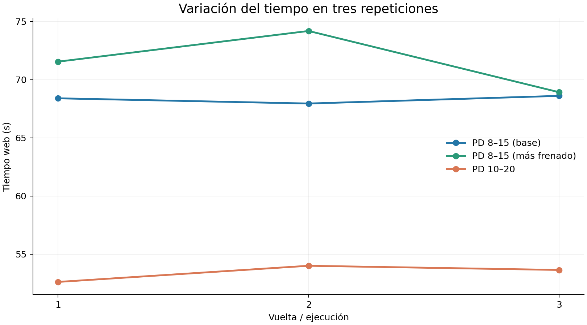

Volver a [[00 - Índice]] · Anterior: [[06 - Experimentos PID]] · Siguiente: [[08 - Comparativa y conclusiones]]

## ¿Por qué probar una velocidad variable?

Después de probar P, PD, PI y PID a velocidad fija (`V = 10`), quisimos comprobar si era posible completar el circuito más deprisa. La idea fue bastante sencilla: avanzar más rápido cuando la línea parece recta y reducir la velocidad cuando se detectan desviaciones o indicios de curva.

Para esta fase seleccionamos **PD** (`Kp = 0,010`, `Kd = 0,001`), porque había dado muy buenos resultados sin necesitar el término integral. También probamos **PID** (`Kp = 0,010`, `Ki = 0,00001`, `Kd = 0,001`) con la misma estrategia inicial de velocidad.

## Cómo se calcula la velocidad

La implementación adapta la velocidad según dos señales visuales: el error horizontal de seguimiento y una estimación de cómo cambia la posición de la línea entre zonas de la imagen. De manera esquemática:

```python
velocidad = max(V_MIN, min(V_MAX,
    V_MAX - K_V_ERROR * abs(error) - K_V_AHEAD * indicador_curva
))
```

Esto **no es una medida física exacta de curvatura**: es una aproximación basada en la imagen. En todos los experimentos se mantuvo la detección del rojo, el seguimiento PD y el mecanismo de recuperación. En caso de pérdida de línea, el controlador empleaba `V_LOST = 4` y `W_LOST = 1,9`.

## Configuraciones estudiadas

| Prueba | Controlador | V_MIN | V_MAX | K_V_ERROR | K_V_AHEAD |
|---|---|---:|---:|---:|---:|
| VA-PD-1 | PD | 8 | 15 | 0,020 | 0,030 |
| VA-PID | PID | 8 | 15 | 0,020 | 0,030 |
| VA-PD-3 | PD | 8 | 15 | 0,025 | 0,045 |
| VA-PD-4 | PD | 10 | 20 | 0,020 | 0,030 |

> **Aclaración de datos:** el `registro.csv` aportado al final identifica VA-PD-4 como `20 / 10`, y la tabla de parámetros confirma `V_MIN = 10` y `V_MAX = 20`. Se utiliza este valor en el resumen.

## Resultados registrados

Se hicieron tres ejecuciones por configuración. Los valores son medias de las métricas finales de cada ejecución, y las pérdidas son el total de los tres recorridos.

| Configuración | Tiempos (s) | Tiempo medio (s) | MAE medio (px) | RMSE medio (px) | Pérdidas | Completadas |
|---|---|---:|---:|---:|---:|---:|
| VA-PD-1 | 68,40 · 67,95 · 68,61 | **68,32** | 72,16 | 97,46 | 0 | 3/3 |
| VA-PID | 70,70 · 73,33 · 69,51 | 71,18 | 72,39 | 97,90 | 0 | 3/3 |
| VA-PD-3 | 71,55 · 74,19 · 68,92 | 71,55 | **67,81** | **92,00** | 0 | 3/3 |
| VA-PD-4 | 52,61 · 54,00 · 53,64 | **53,42** | 126,75 | 154,79 | 1 | 3/3 |

### Lo que observamos

**VA-PD-1** ofrece un buen punto de partida: las tres ejecuciones tienen tiempos muy parecidos y ninguna pérdida de línea. Frente al PD de velocidad fija (85,17 s de media), el tiempo web baja a 68,32 s. A cambio, el MAE aumenta de 58,88 a 72,16 px.

**VA-PD-3** reduce más la velocidad ante desviaciones o curvas. Es la configuración adaptativa con menor MAE y RMSE de las probadas, aunque tarda algo más que VA-PD-1. Parece una opción razonable si priorizamos precisión.

**VA-PD-4**, con velocidad máxima 20, es claramente la más rápida según el tiempo de la web. Pero casi duplica el MAE de VA-PD-3 y registra una pérdida de línea. La mayor velocidad, por tanto, tiene un coste visible en el seguimiento.

**VA-PID** se comporta de forma parecida a VA-PD-1 en error visual, aunque su tiempo web medio es mayor. Con estas pruebas, añadir la integral no ha dado una ventaja clara para la estrategia adaptativa.

## ¿Podemos fiarnos de los tiempos?

Los tiempos los proporciona Unibotics, y hemos observado que pueden depender de la carga gráfica del ordenador. Sirven como orientación, especialmente cuando las diferencias son grandes, pero **no permiten afirmar con total seguridad cuál es más rápido en tiempo de simulación**. Por eso también analizamos MAE, RMSE, pérdidas y número de vueltas completadas.

Otra limitación es que el error está medido en píxeles a partir del centroide de la línea. No es directamente la distancia física del vehículo a ella. Además, las métricas se calculan sobre muestras válidas y la frecuencia de procesamiento puede variar.

## Continuidad durante varias vueltas

Además de las pruebas cronometradas, se comprobó que el programa de control podía **seguir circulando tras completar una vuelta**, y que el vehículo podía realizar dos vueltas consecutivas y continuar. Esta fue una comprobación funcional: no se registraron aquí métricas independientes para cada una de esas vueltas seguidas.

## Conclusión

La velocidad adaptativa permite explorar un compromiso que no se veía en las pruebas a velocidad fija: **ganar tiempo suele implicar aceptar más desviación**. Si buscamos un equilibrio, VA-PD-1 es una buena referencia; si priorizamos el menor error, VA-PD-3; y si queremos estudiar el límite de rapidez, VA-PD-4 es la más exigente de las que hemos probado.

No hay una «mejor» configuración universal: depende de cuánto valoremos la rapidez frente a la precisión y la robustez. Para un sistema que deba seguir el circuito de forma fiable, no elegiría una configuración únicamente por el menor tiempo.

Continúa en [[08 - Comparativa y conclusiones]].

## Gráficas




