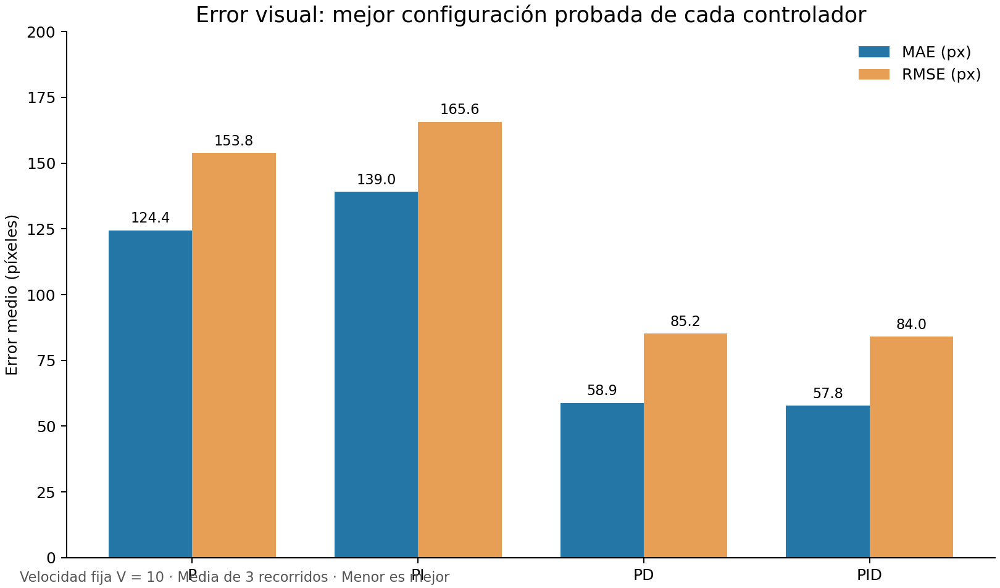
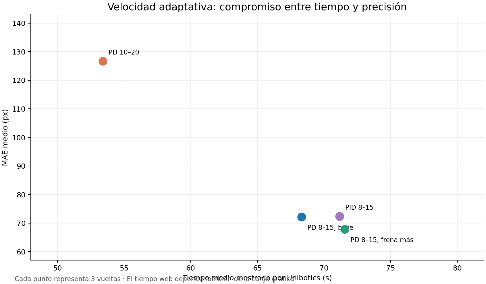

Volver a [[00 - Índice]] · Ver también [[03 - Experimentos P]], [[04 - Experimentos PD]], [[05 - Experimentos PI]], [[06 - Experimentos PID]] y [[07 - Velocidad adaptativa]].

## Qué queríamos averiguar

El objetivo del trabajo no era solo lograr que el coche siguiera la línea roja de Unibotics. Queríamos ver **qué aporta realmente cada término del controlador**: comenzar con P, incorporar la derivada o la integral, reunirlos en PID y, finalmente, estudiar qué ocurre cuando dejamos de utilizar una velocidad constante.

En las pruebas de control se mantuvieron la velocidad lineal en `V = 10`, el mismo procedimiento de detección por cámara y la recuperación de línea (`V_LOST = 4`, `W_LOST = 1,9`). Cada ajuste se probó tres veces y anotamos tiempo web, muestras, pérdidas, MAE y RMSE.

## Comparación a velocidad constante

La tabla recoge **la configuración con menor MAE medio entre las ensayadas** para cada tipo de controlador, no una optimización exhaustiva de sus ganancias.

| Controlador | Ganancias seleccionadas | Tiempo medio (s) | MAE medio (px) | RMSE medio (px) | Pérdidas | Vueltas |
|---|---|---:|---:|---:|---:|---:|
| P | Kp = 0,010 | 88,21 | 124,40 | 153,76 | 2 | 3/3 |
| PI | Kp = 0,010; Ki = 0,00005 | 90,16 | 138,99 | 165,60 | 0 | 3/3 |
| PD | Kp = 0,010; Kd = 0,001 | 85,17 | 58,88 | 85,19 | 0 | 3/3 |
| PID | Kp = 0,010; Ki = 0,00001; Kd = 0,001 | 90,30 | **57,75** | **84,04** | 0 | 3/3 |

### Qué aporta cada término

**P: una base que funciona, pero con oscilaciones.** Con ganancias demasiado pequeñas, como vimos también en exploraciones iniciales, el coche podía responder tarde a las curvas. En las 12 vueltas que registramos para el análisis final, todas las configuraciones completaron el circuito, pero el zigzagueo siguió siendo apreciable. Entre las ganancias probadas, `Kp = 0,010` obtuvo los menores errores medios.

**D: la mejora más clara.** Al añadir la acción derivativa, el seguimiento se volvió visualmente más suave. Los datos también acompañan: el mejor PD redujo el MAE medio de 124,40 a 58,88 px respecto al P seleccionado, aproximadamente un **52,7 %**, y no registró pérdidas en sus tres vueltas. Fue el cambio más importante de todo el estudio.

**I: no fue útil en las condiciones probadas.** Los dos ajustes PI registraron más error medio que el P de referencia y se observó bastante zigzagueo. La integral puede ayudar a eliminar errores persistentes, pero en este circuito el error cambia continuamente y la acumulación puede dar lugar a correcciones menos oportunas. Esto describe **nuestras configuraciones ensayadas**, no demuestra que todos los PI sean peores en cualquier situación.

**PID: una mejora pequeña frente a PD.** El mejor PID obtuvo 57,75 px de MAE frente a los 58,88 px del PD, una diferencia de unos **1,13 px** (aproximadamente un 1,9 %). Con tres repeticiones y la variabilidad del entorno, esa diferencia es demasiado pequeña para afirmar una superioridad general. En estas condiciones, **PD parece suficiente y es más sencillo de ajustar**.

## ¿Qué cambió con la velocidad adaptativa?

Comparamos además PD y PID con una ley de velocidad que acelera cuando el trazado parece favorable y frena ante desviaciones y curvas. Estos son los resultados principales:

| Configuración | Tiempo web medio (s) | MAE medio (px) | RMSE medio (px) | Pérdidas |
|---|---:|---:|---:|---:|
| PD constante, V = 10 | 85,17 | **58,88** | **85,19** | 0 |
| PD variable, 8–15 (VA-PD-1) | 68,32 | 72,16 | 97,46 | 0 |
| PD variable, 8–15, más frenado (VA-PD-3) | 71,55 | 67,81 | 92,00 | 0 |
| PD variable, V_MAX = 20 (VA-PD-4) | **53,42** | 126,75 | 154,79 | 1 |
| PID variable, 8–15 | 71,18 | 72,39 | 97,90 | 0 |

El balance es claro: **la velocidad adaptativa puede reducir los tiempos mostrados por la web, pero al exigir más velocidad aumenta el error de seguimiento**. VA-PD-3 favorece la precisión; VA-PD-4 ofrece menor tiempo a costa de desviaciones considerables. Además, el PD adaptativo inicial superó ligeramente al PID adaptativo en el tiempo mostrado, sin diferencias importantes en error visual.

> **Corrección del registro:** la versión final del CSV especifica `V_MIN = 10` y `V_MAX = 20` para VA-PD-4.

## Limitaciones del experimento

Hay que interpretar estos resultados con cuidado. En primer lugar, el tiempo de Unibotics se ve afectado por el rendimiento gráfico del equipo, de modo que no equivale necesariamente al tiempo transcurrido en la simulación. En segundo lugar, el MAE y el RMSE se calculan con el error horizontal del centroide en la imagen, no con la distancia real del coche a la línea. También influyen el número variable de muestras y la forma de detectar la línea.

Finalmente, hemos probado un conjunto pequeño de ganancias, con tres recorridos por configuración. Nos sirve para comparar tendencias y decisiones de diseño, pero no para encontrar parámetros óptimos globales ni para asegurar diferencias estadísticas pequeñas.

## Conclusión final

Lo que más me ha sorprendido del ejercicio es que **más términos no han significado necesariamente mejor control**. La derivada ha marcado una diferencia grande, mientras que la integral no ha dado una ventaja clara y, utilizada junto con P, incluso ha empeorado el seguimiento respecto a nuestro P de referencia. El PID completo ha logrado los errores más bajos, pero por muy poco frente a PD.

Por eso, si tuviera que elegir una solución para este circuito con los datos disponibles, escogería **PD**: funciona bien, resulta más sencillo y se ha comportado de forma estable. Si el objetivo cambiara de precisión a rapidez, usaría el mismo PD con velocidad adaptativa y elegiría los límites según el margen de error aceptable.

También comprobamos que el controlador puede continuar y completar al menos dos vueltas consecutivas. Con todo ello, el trabajo permite justificar no solo qué implementación ha funcionado mejor en nuestras pruebas, sino **por qué conviene separar el problema del control de dirección del problema de decidir a qué velocidad circular**.

## Archivos relacionados

- [[01 - Fundamentos del control]]
- [[02 - Visión artificial]]
- [[03 - Experimentos P]]
- [[04 - Experimentos PD]]
- [[05 - Experimentos PI]]
- [[06 - Experimentos PID]]
- [[07 - Velocidad adaptativa]]

## Gráficas de apoyo

